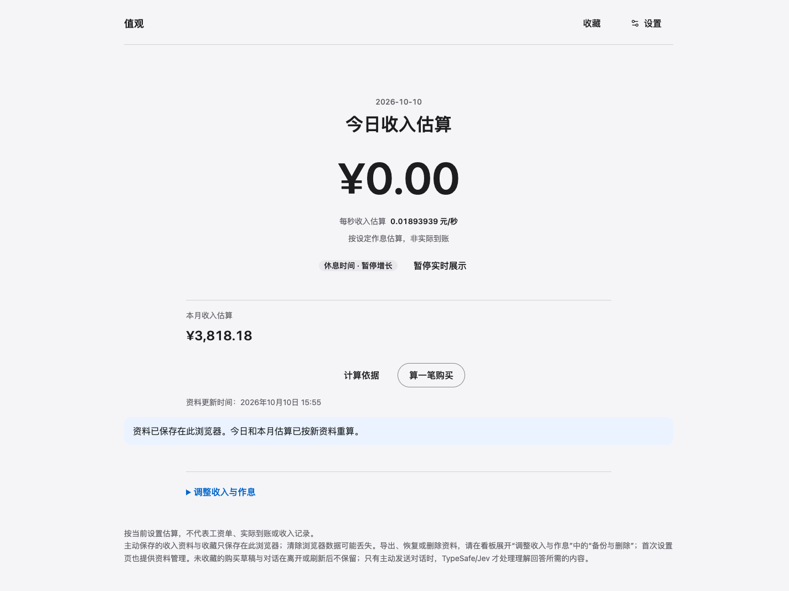

# 值观 · Zhiguan

值观帮助你直观看见时间与收入，也可以按需理解一次购买选择。

**状态：开发中的本机应用。** 当前已实现收入看板、同浏览器资料与收藏、备份恢复和单次购买分析；尚未正式发布，真实用户体验与回滚演练仍待验证。[PRODUCT.md](PRODUCT.md) 描述长期产品愿景，其中订阅、物品使用、目标等对象不代表当前已提供对应功能；当前范围以本页、[产品策略](PRODUCT_STRATEGY.md) 和 [路线图](ROADMAP.md) 为准。

## 当前实现

React + TypeScript + Vite 单页应用：

- 首次只填写到手月收入，默认双休、09:00–12:00 / 13:00–18:00；作息、特殊日期和时区放在折叠设置里。
- 首页展示今日、本月累计收入估算与每秒速率。按保存时区的当月实际排班秒数分摊月收入，工作时增长、休息时暂停；刷新或重新打开按当前时间重算，不把估算说成到账收入。
- 基础资料与主动收藏保存在当前浏览器；无需账户。更换浏览器、清除网站数据不会自动恢复，应主动导出本地备份。
- 购买分析是次级入口，沿用收入与当月日历工时；页面先提供可选的一句话描述，也可随时切换为手动填写，无需发送描述。临时修改不反写基础资料；平均作息或直接月工时仅作为主动选择的单次覆盖。
- 结果保留公式、证据状态和不足原因；余量按需补充，可以记录购买、等待、调整条件、不购买或暂不决定。收藏冻结当时的输入、月份、时区、规则与结果，后续修改资料不改写旧收藏。
- 单次结果下载为 `zhiguan-purchase-decision@2`；资料与收藏的备份为 `zhiguan-local-backup@1`。备份导入通过完整校验并确认后覆盖，旧 `zhiguan-purchase-decision@1` 不自动迁移，也不能作为完整备份导入。
- 普通计算不调用网络，不保存对话原文或未收藏购买草稿；本地写入受浏览器锁与版本检查保护，失败明确提示，避免静默覆盖。

### 开发预览（合成数据）



2026-10-10 在 Mac Chrome 中截取的本机构建预览，月收入 12,000 元及默认作息均为演示输入，不含真实个人财务资料。当日为默认双休中的休息日，因此今日估算为 0；这不是工资或到账记录，也不表示已正式发布。

## 快速开始：无需密钥的基础功能

准备 Git 和 **Bun 1.4.0**（版本由 `package.json` 固定；安装方式见 [Bun 官方文档](https://bun.com/docs/installation#installing-older-versions)）。基础功能不需要 Python、TypeSafe 密钥或 `.env`，无需另装 Node.js/npm。

```sh
git clone https://github.com/alune1212/zhiguan.git
cd zhiguan
bun --version
bun ci
bun run dev --strictPort
```

打开 <http://127.0.0.1:4173>，保存一份收入资料即可进入看板；购买页可切换到“手动填写”，不必使用一句话对话。所有示例、公开截图和测试只使用合成数据。`--strictPort` 让端口占用时明确失败，避免换到不支持 Jev 同源校验的端口；先停止占用 4173 的旧服务再重试。

### 检查与构建预览

```sh
bun run check
# check 包含依赖校验、类型检查、Vitest 测试和构建
bun run preview --strictPort
```

先停止开发服务，再在同一地址 <http://127.0.0.1:4173> 预览 `dist/` 构建产物。也可单独运行 `bun run build` 或 `bun run test`；`bun test` 是 Bun 自带的另一套测试运行器，不是本项目的 Vitest 检查。无密钥 CI 在每次 main 推送和面向 main 的 PR 中执行 `bun ci`、`bun run check`，见 [检查工作流](.github/workflows/check.yml)。

### 备份、恢复与删除

在看板展开“调整收入与作息”中的“备份与删除”（首次设置页也有资料管理）。换浏览器、清除网站数据或回退旧版前，先导出 `zhiguan-local-backup@1` 备份；导入会在校验和确认后覆盖当前资料。页面清空只删除当前访问地址的本地资料，不删除已下载文件，也不能撤回已发送给第三方的请求；详见 [安全与隐私](SECURITY.md)。访问 `localhost`、`127.0.0.1` 或不同端口时，浏览器存储彼此隔离，需要在旧地址导出、在新地址主动恢复。

### 本机 Docker

Docker 是可选运行方式。根目录需要 `.env` 文件；仅使用基础功能时可为空，使用 Jev 时才按下文设置 `TYPESAFE_API_KEY`：

```sh
touch .env
docker compose up -d --build --wait
```

打开 `http://127.0.0.1:4174`。服务在容器内监听映射端口，宿主仅发布到本机回环地址；`.env` 不进入镜像。停止使用 `docker compose stop`。浏览器资料按访问地址隔离：此前存在 `127.0.0.1:4173` 的资料，需从旧页面导出备份后在 4174 页面主动恢复。

### 可选：本机 Jev 对话输入

只有需要自然语言整理购买输入时，才准备 [uv](https://docs.astral.sh/uv/getting-started/installation/) 和 Python 3.14+，并在项目根目录 `.env` 设置 `TYPESAFE_API_KEY=你的密钥`（已被 Git 忽略，不使用 `VITE_` 前缀，不要提交或放进截图）。Python 与 SDK 由 uv 和 `uv.lock` 管理：

```sh
uv sync --locked
bun run build
uv run --locked --env-file .env scripts/jev_server.py
```

打开 <http://127.0.0.1:4174> 可使用带 Jev 的本机版本。开发时保持 Python 服务运行，在另一终端运行 `bun run dev --strictPort`，<http://127.0.0.1:4173> 会将 `/api/assist` 转发到 Python 服务；Vite 预览也配置了同一代理。服务默认仅绑定回环地址，不用于公开或多人部署。密钥缺失或服务不可用时，仍可使用看板和手动填表。

打开页面不会自动请求 Jev。首次主动发送前，页面说明 TypeSafe/Jev 将处理当前回答、当前问题及理解所需的少量相关字段或原文片段；不会发送完整表单、全部聊天记录、价值期待或决定理由。手动填写和快捷按钮不调用 Jev。服务不记录请求或模型响应正文；对话原文不进入 JSON 导出。发出的请求无法由本地取消或清空撤回，不承诺第三方数据保留政策，请勿输入身份信息。识别或服务失败时保留当前回答和草稿，用户可主动重试或切换到手动填写；系统不自动重试。

后端离线检查：`uv run --locked python -m unittest discover -s scripts -p 'test_jev_server.py'`。此命令不调用模型。当前对话的虚构样本检查与真实实验：

```sh
uv run --locked scripts/jev_conversation_experiment.py --self-check
uv run --locked --env-file .env scripts/jev_conversation_experiment.py --run --output tmp/jev-conversation-results.jsonl
```

第二条命令会发送真实请求，每样本每轮一次且不自动重试；输出文件须不存在。使用 `--cases` 可选择其他固定虚构样本，勿写入个人财务数据。首版三字段历史实验见 ADR-0006。

### 依赖维护

新增依赖使用 `bun add <包名>`（开发依赖加 `--dev`），默认保存精确版本；依赖变更一并提交 `package.json` 和 `bun.lock`。干净安装及 CI 使用 `bun ci`，锁文件与声明不一致时失败。

各依赖包自带的安装脚本默认全部禁用，确需执行时先审查再加入 `trustedDependencies`。项目自身的 `postinstall` 和 `bun run check` 都会检查 peer dependencies，缺少必要依赖或版本不兼容时失败。`bunfig.toml` 统一使用 Bun 运行时，并关闭运行时自动安装依赖。

## 产品与实现边界

Jev 对话输入的当前接入边界见 [ADR-0007](docs/adr/ADR-0007-conversational-input.md)；[ADR-0006](docs/adr/ADR-0006-jev-integration.md) 和虚构样本实验仅记录首版历史。金额计算复用确定性逻辑；收入看板与本地保存边界见 [PRD-0003](docs/product/prd/PRD-0003-income-dashboard.md) 和 [ADR-0008](docs/adr/ADR-0008-local-profile-and-purchase-favorites.md)。旧导出格式保留历史含义，新结果与备份使用不同格式。

- 长期产品定义见 [产品宪法](PRODUCT.md)，当前优先级见 [产品策略](PRODUCT_STRATEGY.md) 和 [路线图](ROADMAP.md)，实现边界见 [架构](ARCHITECTURE.md)。
- 购买功能短规格见 [PRD-0001](docs/product/prd/PRD-0001-single-purchase-decision-workbench.md)；[PRD-0002](docs/product/prd/PRD-0002-goal-progress.md) 已于 2026-09-01 按回滚条件退役，仅保留历史记录。
- 当前不可逆技术决定见 [ADR 索引](docs/adr/README.md)。
- [术语](docs/product/glossary.md)、[指标](docs/product/metrics.md)、[数据原则](docs/product/data-principles.md) 和 [品牌边界](docs/design/brand.md) 说明产品用语与限制。

不在当前范围内：独立 Goal 进度、账户、完整记账、数据库、同步、提醒、研究招募、公开发布、排名、人生总分和替用户做决定。当前实现与使用反馈不构成研究或市场结论；研究招募暂停，也不是当前开发前置条件。

本地数据可先导出备份，再通过页面确认清空；下载到设备的文件需自行管理。回退旧应用前应保留备份，旧版不会读取或转换新数据。浏览器验证不等于真实用户体验反馈或生产发布，回滚演练仍需另行验证。

## 许可状态

本仓库尚未提供项目级 `LICENSE`，不声明以 MIT 或其他开源许可证授权项目代码、文档或素材。公开可见不等于已获得项目级复用许可。依赖和第三方组件各自的许可证仅适用于其组件，不构成对本项目的许可；具体使用需核对对应组件的许可证与通知。
