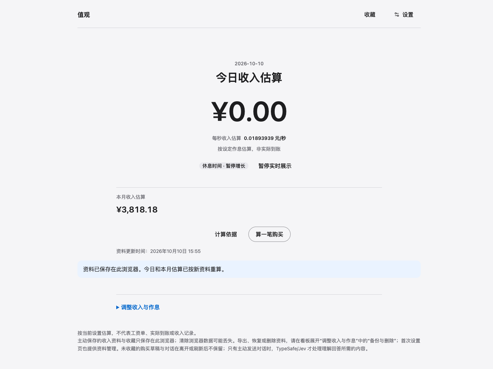

# 值观 · Zhiguan

值观要帮你在一笔购买前看清自己的数字，听完不同说法，再自己决定。

**状态：开发中的本机应用。** 现行方向见 [产品宪法](PRODUCT.md) 1.0.1 和 [RFC-0002](docs/product/rfc/RFC-0002-purchase-council.md)。阶段一购买讨论已接入：首页是「讨论这笔购买」，秒薪看板留在收入资料页。尚未正式发布，真实用户体验与回滚演练仍待验证。已实现范围以本页为准，接下来做什么见 [路线图](ROADMAP.md)。

## 当前实现

React + TypeScript + Vite 单页应用：

- 首次只填写到手月收入，默认双休、09:00–12:00 / 13:00–18:00；作息、特殊日期和时区放在折叠设置里。没有有效资料时仍先进入这份设置。
- 打开应用后进入「讨论这笔购买」。事实卡在本地计算，不发送请求也能看到。人物讨论要先预览全文并确认。五种决定仍由用户自己选。
- 原来的今日、本月累计与每秒速率留在「收入资料」页，不删除。按保存时区的当月计划工作秒数分摊月收入，工作时增长、休息时暂停；不把估算说成到账收入。
- 基础资料、收藏和已完成的讨论保存在当前浏览器；无需账户。讨论使用单独的存储键，不写入 `zhiguan-local-backup@1` 的原有字段。更换浏览器、清除网站数据不会自动恢复，应主动导出本地备份。
- 收入资料页仍可进入原来的单次购买计算。临时修改不反写基础资料；平均作息或直接月工时只作为那次计算的覆盖，不进入讨论事实卡。
- 结果保留公式、证据状态和不足原因。收藏冻结当时的输入、月份、时区、规则与结果，后续修改资料不改写旧收藏。
- 单次结果下载为 `zhiguan-purchase-decision@2`。现在导出的资料备份是 `zhiguan-local-backup@2`，里面包含原来的资料文档和讨论记录。旧的 `@1` 备份仍可导入，只替换收入资料和收藏，不删除已保存的讨论。旧 `zhiguan-purchase-decision@1` 不自动迁移，也不能作为完整备份导入。
- 事实卡不调用网络。讨论和一句话解析只有在本机服务可用、并且用户确认后才会发送。未完成的讨论不落盘。本地写入受浏览器锁与版本检查保护，失败明确提示，避免静默覆盖。

### 开发预览（合成数据）



2026-10-10 在 Mac Chrome 中截取的本机构建预览，月收入 12,000 元及默认作息均为演示输入，不含真实个人财务资料。当日为默认双休中的休息日，因此今日估算为 0；这不是工资或到账记录，也不表示已正式发布。

## 快速开始：无需密钥的基础功能

准备 Git 和 **Bun 1.4.2**（版本由 `package.json` 固定；安装方式见 [Bun 官方文档](https://bun.com/docs/installation#installing-older-versions)）。基础功能不需要 Python、TypeSafe 密钥或 `.env`，无需另装 Node.js/npm。

```sh
git clone https://github.com/alune1212/zhiguan.git
cd zhiguan
bun --version
bun ci
bun run dev --strictPort
```

打开 <http://127.0.0.1:4173>，保存一份收入资料后进入「讨论这笔购买」。没有 DeepSeek 密钥时，事实卡和五种决定仍可使用，讨论会标明不可用。所有示例、公开截图和测试只使用合成数据。`--strictPort` 让端口占用时明确失败；先停止占用 4173 的旧服务再重试。

### 检查与构建预览

```sh
bun run check
# check 包含依赖校验、类型检查、Vitest 测试和构建
bun run preview --strictPort
```

先停止开发服务，再在同一地址 <http://127.0.0.1:4173> 预览 `dist/` 构建产物。也可单独运行 `bun run build` 或 `bun run test`；`bun test` 是 Bun 自带的另一套测试运行器，不是本项目的 Vitest 检查。无密钥 CI 在每次 main 推送和面向 main 的 PR 中使用 `package.json` 指定的 Bun 执行 `bun ci`、`bun run check`，并用锁定的 Python 3.14 依赖运行历史实验脚本的离线单元测试和虚构样本自检，不调用 DeepSeek，见 [检查工作流](.github/workflows/check.yml)。

### 备份、恢复与删除

在收入资料页展开“调整收入与作息”中的“备份与删除”（首次设置页也有资料管理）。换浏览器、清除网站数据或回退旧版前，先导出 `zhiguan-local-backup@2` 备份；导入会在校验和确认后覆盖。页面清空会删除当前访问地址的收入资料、收藏和已保存讨论，不删除已下载文件，也不能撤回已经发送给服务商的请求；详见 [安全与隐私](SECURITY.md)。讨论页里的「全部清除」只删除已保存的讨论。访问 `localhost`、`127.0.0.1` 或不同端口时，浏览器存储彼此隔离，需要在旧地址导出、在新地址主动恢复。

### 本机 Docker

Docker 是可选运行方式。根目录需要 `.env` 文件；只使用事实卡和收入资料时可以为空。要启用讨论和一句话解析时，在 `.env` 设置 `DEEPSEEK_API_KEY`（见下文）：

```sh
touch .env
docker compose up -d --build --wait
```

打开 `http://127.0.0.1:4174`。服务在容器内监听映射端口，宿主仅发布到本机回环地址；`.env` 不进入镜像。停止使用 `docker compose stop`。浏览器资料按访问地址隔离：此前存在 `127.0.0.1:4173` 的资料，需从旧页面导出备份后在 4174 页面主动恢复。

### 可选：本机讨论服务

讨论和一句话解析由小型 Hono 服务转发到 DeepSeek。密钥只放在服务端环境变量 `DEEPSEEK_API_KEY`，不要加 `VITE_` 前缀，不要提交，也不要放进截图。可选的 `DEEPSEEK_API_BASE` 默认是 `https://api.deepseek.com`。项目根目录的 `.env` 已被 Git 忽略；服务启动时如果文件存在，会读取其中尚未设置的变量。

```sh
# .env 示例（不要提交真实密钥）
# DEEPSEEK_API_KEY=你的密钥
bun run server
```

开发时保持这个服务运行，另开终端执行 `bun run dev --strictPort`。页面在 <http://127.0.0.1:4173>，`/api` 会转发到 <http://127.0.0.1:4174>。`bun run build` 之后也可以直接打开 <http://127.0.0.1:4174>，由同一个服务提供页面和接口。服务默认只绑定回环地址，不用于公开或多人部署。

浏览器只请求这个同源服务。讨论接口是 `/api/discussion/persona` 和 `/api/discussion/synthesis`，一句话解析是 `/api/parse`，两者分开。服务不记录请求正文、响应正文、事实卡或提示词；失败时只留下不含正文的类别。没有密钥或服务不可用时，事实卡和五种决定仍可使用，讨论标明不可用，不会自动重试。

每次新的讨论载荷都要先看到全文，包括服务商名称 DeepSeek 和实际主机名，确认后才发送。取消或关闭页面不会补发。已经发出的内容不能靠本地删除撤回。一句话解析只上传这句话，不上传整份收入资料。请不要输入身份信息。

`scripts/jev_server.py` 不再承担这个角色。仓库里的 Python 脚本只保留历史实验；自动化检查不调用 DeepSeek。

### 依赖维护

新增依赖使用 `bun add <包名>`（开发依赖加 `--dev`），默认保存精确版本；依赖变更一并提交 `package.json` 和 `bun.lock`。干净安装及 CI 使用 `bun ci`，锁文件与声明不一致时失败。

各依赖包自带的安装脚本默认全部禁用，确需执行时先审查再加入 `trustedDependencies`。项目自身的 `postinstall` 和 `bun run check` 都会检查 peer dependencies，缺少必要依赖或版本不兼容时失败。`bunfig.toml` 统一使用 Bun 运行时，并关闭运行时自动安装依赖。

## 产品与实现边界

购买讨论的外发边界见 [ADR-0009](docs/adr/ADR-0009-llm-purchase-discussion.md)，交互见 [PRD-0004](docs/product/prd/PRD-0004-purchase-council.md)。一句话解析仍不发送完整收入资料，也不生成购买建议。金额计算复用确定性逻辑；收入资料与本地保存见 [PRD-0003](docs/product/prd/PRD-0003-income-dashboard.md) 和 [ADR-0008](docs/adr/ADR-0008-local-profile-and-purchase-favorites.md)。旧导出格式保留历史含义。

- 产品宪法见 [PRODUCT.md](PRODUCT.md)。购买讨论的提案是 [RFC-0002](docs/product/rfc/RFC-0002-purchase-council.md)、[PRD-0004](docs/product/prd/PRD-0004-purchase-council.md) 和 [ADR-0009](docs/adr/ADR-0009-llm-purchase-discussion.md)。当前优先级见 [产品策略](PRODUCT_STRATEGY.md) 和 [路线图](ROADMAP.md)，已实现代码的边界见 [架构](ARCHITECTURE.md)。
- 已实现的购买计算见 [PRD-0001](docs/product/prd/PRD-0001-single-purchase-decision-workbench.md)，收入看板见 [PRD-0003](docs/product/prd/PRD-0003-income-dashboard.md)。[PRD-0002](docs/product/prd/PRD-0002-goal-progress.md) 已于 2026-09-01 按回滚条件退役，仅保留历史记录。
- 技术决定见 [ADR 索引](docs/adr/README.md)。
- [术语](docs/product/glossary.md)、[指标](docs/product/metrics.md)、[数据原则](docs/product/data-principles.md) 和 [品牌边界](docs/design/brand.md) 说明产品用语与限制。

当前代码不包括：购后回访、公开分享、独立 Goal 进度、账户、完整记账、数据库、同步、提醒、研究招募、公开发布、排名、人生总分和替用户做决定。当前实现与使用反馈不构成研究或市场结论；研究招募暂停，也不是当前开发前置条件。

本地数据可先导出备份，再通过页面确认清空；下载到设备的文件需自行管理。回退旧应用前应保留备份，旧版不会读取或转换新数据。浏览器验证不等于真实用户体验反馈或生产发布，回滚演练仍需另行验证。

## 许可状态

本仓库尚未提供项目级 `LICENSE`，不声明以 MIT 或其他开源许可证授权项目代码、文档或素材。公开可见不等于已获得项目级复用许可。依赖和第三方组件各自的许可证仅适用于其组件，不构成对本项目的许可；具体使用需核对对应组件的许可证与通知。
